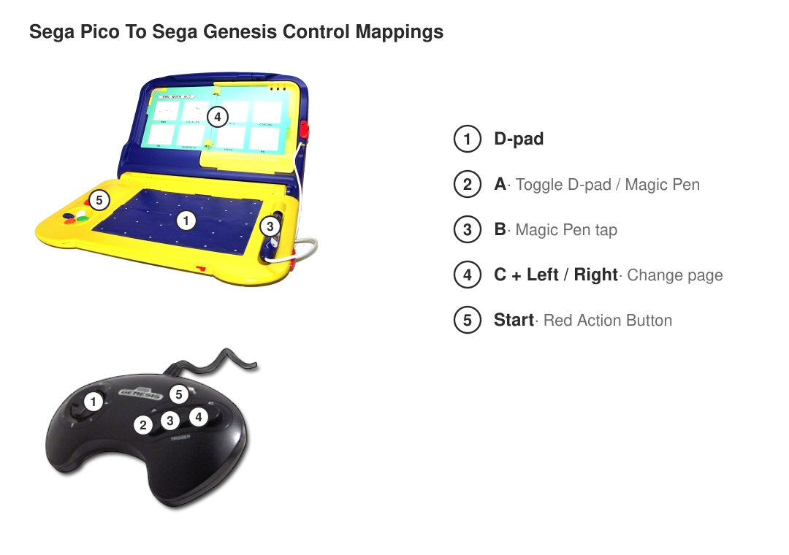

# sonic-gameworld-genesis

**Sonic The Hedgehog's Gameworld** (Sega Pico, 1994), ported to the Sega Mega
Drive / Genesis and played with a normal controller.

The Pico was a children's console shaped like a storybook: a pen on a drawing
tablet, a sensor reading which page is open, one red button and a D-pad. Its
ROMs are already Mega Drive code, same 68000, same VDP, same header slot, so
the port is not a recompile. It is a substitution: everywhere the game reaches
for hardware a Mega Drive does not have, something it does have answers
instead.

**It ships a patch, never a ROM.** You bring your own dump of the original.

## State

| | |
|---|---|
| Pico I/O registers found | 5, across 11 sites |
| patched | Z80 silenced, all Pico I/O including the $800015 handshake, TMSS unlock, page sensor, console string, header |
| not patched | nothing known |
| audio | the PSG plays as it always did; the Pico's sampled voice is gone |
| in Genesis Plus GX and PicoDrive | boots to the title screen and first menu |
| in BlastEm (accuracy core) | runs, zero unmapped accesses |
| in OpenEmu | boots: the core that matched the console all along |
| tested on hardware | black until now: an unmapped write stalled the 68000 at the first instruction. Retest pending |

The pad works: D-pad, B as the Pico's red button, Start standing in for the
pen. What it cannot do is point, because the pen is an absolute coordinate and
a pad has none, so anything that needs a cursor placed somewhere specific is
still out of reach. [FINDINGS.md](FINDINGS.md) quotes the decoded code and the
measurements behind every claim here.

## Build

```
cp .env.sample .env     # fill PICO_ROM
./build.sh
```

Writes `rom/` (gitignored) and an `.ips` beside it.



## Controls

| pad | Pico |
|---|---|
| D-pad | moves the hand, which is always on screen |
| A | switches the D-pad between the hand and the game's own directions; the hand parks in the corner while the game has it |
| B | taps where the hand is |
| C held + Left/Right | turns the storybook page, wrapping through closed |
| Start | the red button (red for red) |

The hand is visible all the time because the Pico reports **where** the pen is
separately from **whether its tip is pressed**. Resting on the tablet draws the
hand and selects nothing; the tip switch is the click. Nothing is rendered by
the patch: the game draws its own hand, it just needed to be told the pen is
there.

There is no page sensor on a Mega Drive, and on this game the page *is* the
mode selector, so turning it from the pad is what makes more than one of its
activities reachable from a single build.

## The storyware pages

The page sensor is the game's mode selector, so each page is a different set of
minigames. **The US and Japanese releases are not the same game**: Sega cut the
gambling, fortune-telling and rock-paper-scissors content for North America,
which removed the Japanese third page, moved the remaining games around, and
put a drawing page in its place. So "it is a drawing game" is one page of the
US dump.

* [StrategyWiki](https://strategywiki.org/wiki/Sonic_the_Hedgehog%27s_Gameworld), zones and the US/JP differences
* [Sega Retro](https://www.segaretro.org/Sonic%27s_Gameworld)
* [DJCUBE's review](https://djcube.co.uk/sonic-the-hedgehogs-gameworld/), the only page-by-page list of the minigames

## Both dumps

The patcher finds its sites by **signature**, not by address, so it converts
the Japanese build as well as the USA one. Same code, different addresses:

| | USA | Japan |
|---|---|---|
| pad read | `$0003FE` | `$0003F8` |
| pen X / Y | `$000664` / `$00068C` | `$000584` / `$0005B2` |
| sound status | `$06D1D4` | `$0690F6` |
| stubs land in filler at | `$0617C6` | `$0194BA` |

Even the stub placement is found per ROM: the USA build's 43 KB of `$FF` near
the end is artwork in the Japanese one. The handshake and sound modules are
byte-identical between the two, which is why both report the same counts.

## License

GPL-3.0-or-later. See [LICENSE](LICENSE).
